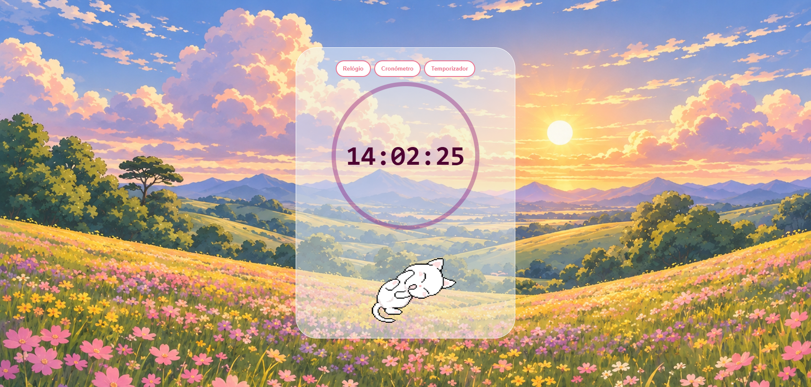

# ⏰ Relógio Virtual

## 📌 Sobre o projeto

O **Relógio Virtual** é uma aplicação web que reúne três funcionalidades em uma única interface: relógio digital, cronômetro e temporizador. Além disso, o projeto possui um plano de fundo dinâmico, que muda de acordo com o período do dia.

## ⚙️ Funcionalidades

### 🕒 1. Relógio
Exibe as horas em tempo real, atualizadas automaticamente.

### ⏱️ 2. Cronômetro
Ao selecionar o modo cronômetro, a interface permite controlar a contagem do tempo por meio das seguintes opções:

- **Começar:** inicia a contagem do tempo.
- **Parar:** pausa o cronômetro.
- **Zerar:** reinicia o cronômetro, retornando o tempo a zero.

### ⏳ 3. Temporizador
Ao selecionar o modo temporizador, é possível configurar um tempo específico para a contagem regressiva.

- **Editar:** exibe um formulário para definir as horas, os minutos e os segundos.
- **Redefinir:** restaura o temporizador, zerando o tempo configurado.
- **Iniciar:** inicia a contagem regressiva.

Ao atingir o tempo definido, o temporizador exibe um aviso na tela e reproduz um alerta sonoro para informar que o tempo terminou.

### 🌅 4. Plano de fundo dinâmico
A imagem de fundo é atualizada de acordo com o período do dia, com três modos de exibição:

- Manhã
- Tarde
- Noite

## 🛠️ Tecnologias utilizadas

- **JavaScript:** implementação das funcionalidades e da lógica da aplicação.
- **CSS:** estilização da interface e personalização do plano de fundo.
- **Firebase Hosting:** hospedagem da aplicação web.

## 🚀 Acesse o projeto

Você pode testar a aplicação diretamente pelo link:

🔗 [Relógio Virtual — Acessar aplicação](https://meu-relogio-online.web.app/)
